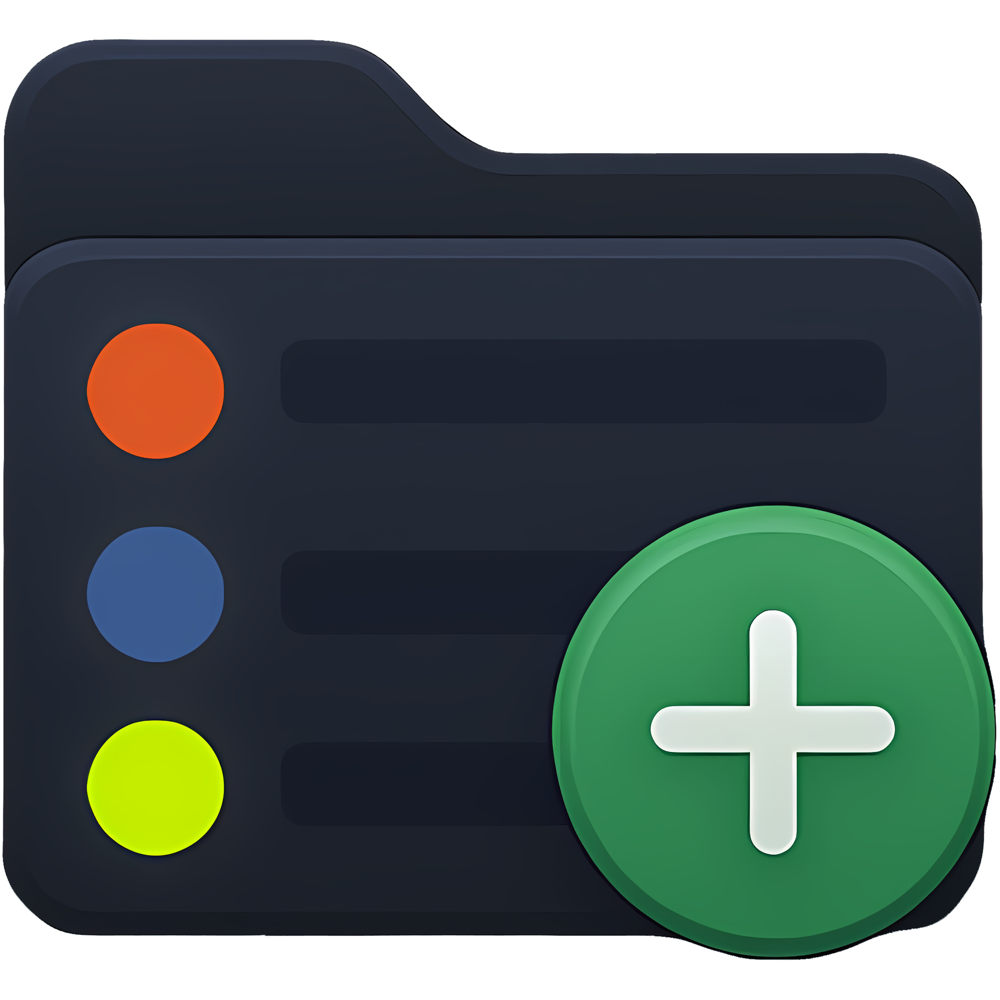
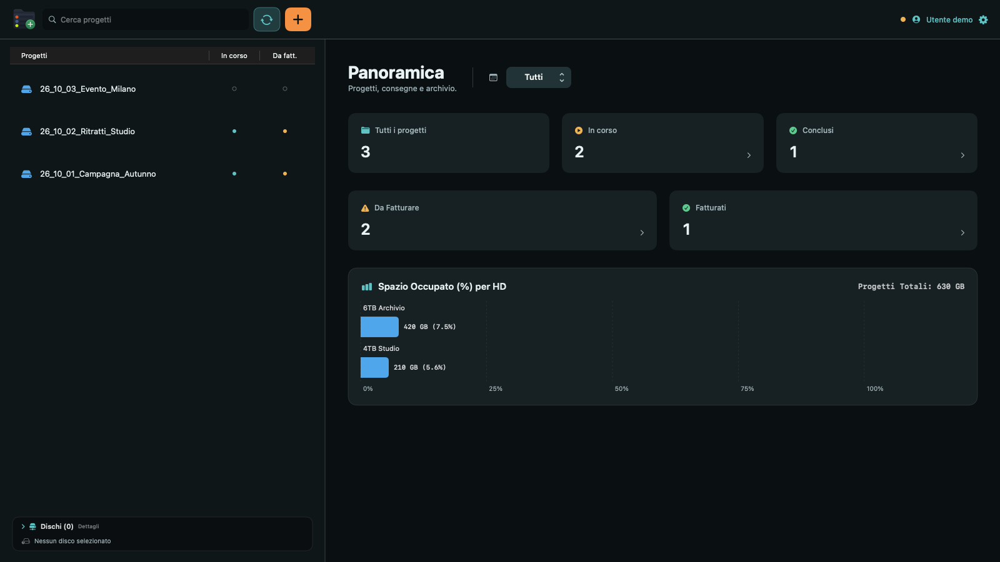
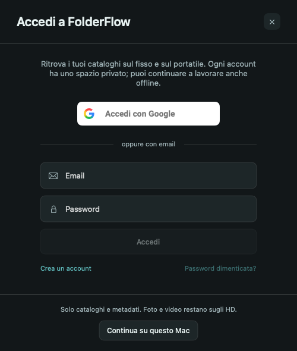
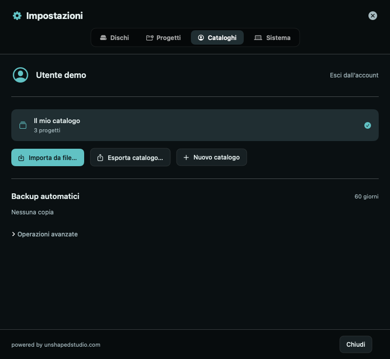
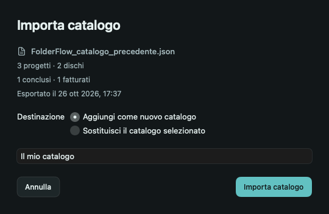

# FolderFlow

**Progetti fotografici e video, organizzati fra i tuoi hard disk.**

Un catalogo per ritrovare i lavori, seguire consegne e fatturazione e consultare l'archivio anche quando i dischi non sono collegati. App nativa per macOS, realizzata da [Unshaped Studio](https://unshapedstudio.com/).

## Scarica e installa

La versione corrente è **5.1.3, anteprima di sviluppo**.

- **[Scarica i sorgenti](https://github.com/marcovernetto-lgtm/FolderFlow/archive/refs/tags/v5.1.3.zip)** per compilarla sul tuo Mac.
- **[Versioni e note di rilascio](https://github.com/marcovernetto-lgtm/FolderFlow/releases)**.
- **[Compilazione, firma e creazione degli installer](docs/BUILD.md)**.

La build firmata durante lo sviluppo ha un profilo temporaneo legato ai Mac registrati e non è notarizzata. Il DMG e lo ZIP restano nella release in bozza: non sono ancora un download pubblico pronto per qualsiasi Mac. Per provarla su un altro computer, apri il progetto in Xcode e scegli il tuo team Apple seguendo la guida.

## Il tuo archivio, a colpo d'occhio

La panoramica mostra quanti lavori sono in corso, conclusi, da fatturare e fatturati. Il grafico ordina i dischi per percentuale occupata dai progetti del catalogo.



*Le immagini di questa guida usano dati dimostrativi.*

### Ritrova un progetto

- Cerca per nome, percorso o disco nella barra in alto.
- Seleziona un progetto e usa le frecce su e giù per spostarti nell'elenco.
- Filtra i lavori dai pulsanti dei dischi in basso a sinistra. Compaiono solo i dischi collegati e selezionati per il monitoraggio.
- Scorri sul selettore dell'anno per cambiare periodo. All'apertura parte da **Tutti**; un nuovo anno compare quando il catalogo contiene il primo progetto di quell'anno.

### Leggi gli stati senza aprire ogni lavoro

| Colonna nella lista | Pallino pieno | Cerchietto vuoto |
| --- | --- | --- |
| **In corso** | Azzurro: lavoro in corso | Lavoro concluso |
| **Da fatt.** | Ambra: da fatturare | Già fatturato |

Nel dettaglio puoi cambiare lavorazione e fatturazione, impostare una scadenza, aggiungere note e aprire la cartella nel Finder.

### Crea e aggiorna i lavori

Il pulsante arancione **+** crea un nuovo progetto sul disco scelto. Prima della creazione vedi il nome della cartella e i dischi disponibili. Il formato originale è `{AA}_{MM}_{NN}_{Nome}`: puoi cambiarlo con i formati pronti o con un formato personalizzato in **Impostazioni → Progetti**.

Il pulsante azzurro accanto al più aggiorna il catalogo dai dischi collegati. La stessa nomenclatura viene usata per creare e riconoscere i progetti; cambiarla non rinomina le cartelle già esistenti.

## Stesso account, cataloghi su più Mac

Puoi usare l'app localmente oppure accedere con Google o email e password. Ogni account ha il proprio spazio per cataloghi e preferenze.



Le modifiche al catalogo vengono salvate sul Mac anche offline e inviate al ritorno della connessione. Su un altro Mac puoi consultare i progetti senza collegare gli HD originali. Una modifica concorrente allo stesso elemento viene mostrata come conflitto: scegli quale versione mantenere.

**Foto e video restano sugli hard disk.** Il cloud riceve cataloghi e metadati, compresi nomi, percorsi, dimensioni, contenuti delle cartelle, stati e note. Non trasferisce i file multimediali.

### Profilo, impostazioni e cataloghi

Clicca sul nome del profilo o sull'ingranaggio in alto a destra. Nella scheda **Cataloghi** puoi cambiare archivio, crearne uno nuovo, importare o esportare un JSON e accedere alle copie di sicurezza.



I colori degli HD e la nomenclatura seguono il catalogo. Le preferenze di avvio all'accesso e barra dei menu seguono l'account. Percorsi, dischi monitorati e autorizzazioni macOS restano invece specifici di ogni computer.

### Importa il catalogo che usi già

1. Esporta il JSON dalla versione precedente di FolderFlow.
2. Apri **Impostazioni → Cataloghi → Importa da file…**.
3. Controlla l'anteprima con numero di progetti e stati.
4. Aggiungi un nuovo catalogo oppure sostituisci quello selezionato. Prima di una sostituzione l'app crea una copia locale di recupero.



### Backup automatici

Con l'account connesso, l'app crea in background una copia online dei cataloghi a ogni avvio. Se parte offline, riprova quando torna la connessione durante l'esecuzione dell'app.

Le copie vengono conservate per **60 giorni**. La pulizia avviene mentre FolderFlow è aperta e online e riguarda soltanto le copie scadute: **non elimina cataloghi o progetti**. Puoi scegliere una copia nella scheda Cataloghi e ripristinarla dopo l'anteprima. Le copie locali di recupero sono nelle operazioni avanzate.

## Requisiti e stato delle verifiche

- macOS **13 o successivo**.
- Build universale per **Apple Silicon e Intel**.
- Per compilare: Xcode e un team Apple per la firma; dettagli nella [guida di sviluppo](docs/BUILD.md).

Sono stati eseguiti 45 test Swift e 7 test delle regole Firestore. Le verifiche con dati isolati coprono importazione, uso offline, conflitti, separazione degli account e backup; l'interfaccia è stata renderizzata a finestra larga e compatta. Sul Mac di sviluppo sono stati verificati accesso Google, catalogo locale/cloud e backup online con checksum.

Il collaudo reale fra fisso e portatile e la distribuzione su Mac diversi restano da completare. Una build firmata per lo sviluppo non dimostra la compatibilità di un installer pubblico.

## Per chi sviluppa

Sorgenti SwiftUI in `Sources/FolderFlow`, test in `Tests`, progetto Xcode e configurazione in radice. Il backend usa Firebase Authentication e Firestore; regole e test sono in [Backend](Backend/README.md).

```sh
swift test
```

La repository non contiene cataloghi personali, backup degli utenti, sessioni di accesso, chiavi private o certificati di firma. La configurazione client Firebase è pubblica e non concede accesso amministrativo al backend.

---

powered by [unshapedstudio.com](https://unshapedstudio.com/)
